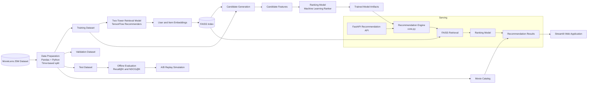

## 🏗️ Architecture



## 🔄 Data Flow

1. **Data Preparation:** MovieLens 25M ratings and movie metadata are processed using Python and Pandas. The dataset is split chronologically into 80% training, 10% validation, and 10% testing data.

2. **Stage 1 – Candidate Retrieval:** A TensorFlow Recommenders two-tower model learns user and item embeddings. The generated item embeddings are indexed using FAISS for similarity-based candidate retrieval.

3. **Stage 2 – Candidate Ranking:** Candidate movies are scored using a trained machine learning ranking model. The ranker uses available user, item, and retrieval-related features to improve recommendation ordering.

4. **Recommendation Serving:** FastAPI exposes recommendation endpoints. The recommendation engine retrieves candidate movies using FAISS and optionally applies the trained ranking model.

5. **Cold-Start Handling:** The system includes a popularity-based recommendation baseline for comparison. Genre-based discovery is available through the application where supported.

6. **Evaluation:** The system is evaluated using Recall@K and NDCG@K. An offline A/B replay simulation compares retrieval and ranking recommendation strategies.

7. **Movie Poster Integration:** MovieLens movie IDs are mapped to TMDB IDs using `links.csv`. Poster URLs are stored in a JSON cache and displayed in the Streamlit interface.

## 🌐 API

### Recommendation Endpoint

```http
GET /recommend/{user_id}?k=10&mode=ranker
```

**Query Parameters:**

| Parameter | Description | Example |
|---|---|---|
| user_id | MovieLens user identifier | `u95080` |
| k | Number of recommendations | `10` |
| mode | Recommendation strategy | `ranker` or `retrieval` |
| genres | Optional genre filter, if supported | `Comedy` |

**Example Request:**

```http
GET http://127.0.0.1:8000/recommend/u95080?k=10&mode=ranker
```

**Example Response:**

```json
{
  "user_id": "u95080",
  "cached": false,
  "latency_ms": 1218.78,
  "items": [
    {
      "item_id": "example",
      "title": "Movie Title",
      "genres": "Drama",
      "score": 0.85,
      "source": "retrieval+ranker"
    }
  ]
}
```

*The response above illustrates the API structure; actual movie IDs, titles, and scores are generated by the running model.*

### Health Check

```http
GET /health
```

Reports API health and available service information, including Redis and ranker status where implemented.

### API Documentation

Once the FastAPI server is running, access interactive documentation at:

http://127.0.0.1:8000/docs

## 📊 Evaluation

The recommendation engine is evaluated using:

- **Recall@K:** Measures how many relevant movies appear in the top K recommendations.
- **NDCG@K:** Measures the quality of the ranking of relevant recommendations.
- **Offline A/B Replay:** Compares retrieval and ranking strategies using simulated offline interactions.

The current experiment uses a sampled MovieLens dataset and offline evaluation. Results should not be interpreted as live production performance.

## 🚀 Future Architecture Improvements

- Apache Spark for distributed feature engineering.
- Redis caching for faster recommendation responses.
- Apache Airflow for scheduled model retraining.
- NVIDIA Triton for scalable model serving.
- Improved cold-start personalization.
- Real-time user interaction and feedback collection.
- Production monitoring and live A/B testing.